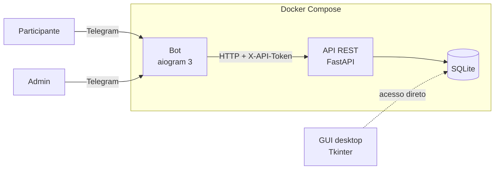
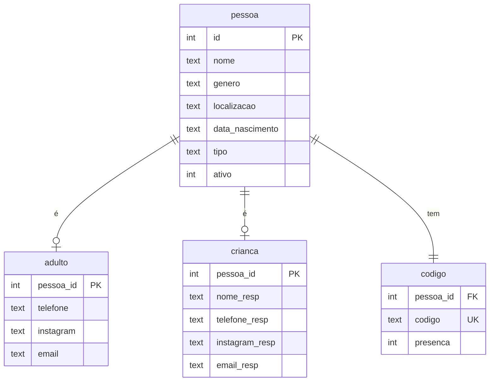

# Evento Lleida: inscrição e check-in pelo Telegram

Sistema de inscrição e controle de entrada para eventos presenciais. Os participantes
se inscrevem por um **bot do Telegram** e recebem um código curto (ex: `H567`). Na
entrada, a organização confere o código pelo próprio bot e marca a presença. No fim do
evento, o bot gera a lista de `@` do Instagram de quem compareceu, pronta para marcar
no post.

> O bot conversa com o público em espanhol (o evento é em Lleida, Espanha). O código e
> os comentários estão em português.

## Funcionalidades

**Participante**
- Inscrição guiada passo a passo, com botões e validação de cada campo (data, telefone, email, Instagram)
- Dois fluxos: **adulto** ou **criança** (com dados do responsável)
- Tela de revisão antes de confirmar e código único no final

**Organização (admins)**
- Check-in: manda o código no chat, vê a ficha e confirma a presença com um botão
- `/inscritos`: todos os inscritos, com marcação de quem já chegou
- `/presentes`: só quem já fez check-in
- `/mencoes`: `@` de todos os presentes, sem repetição, prontos para copiar

## Arquitetura



São dois processos separados:

- **API (FastAPI)**: a única dona do banco. Valida os dados (Pydantic), gera os códigos
  e aplica as regras (ex: presença marcada duas vezes).
- **Bot (aiogram)**: só interface. Conduz a conversa com uma máquina de estados (FSM)
  e chama a API por HTTP. Não conhece SQL.

A separação permite trocar ou acrescentar interfaces (um site, um app de leitura de
QR code) sem tocar na regra de negócio.

## Stack

| Camada | Tecnologia |
|---|---|
| Bot | Python 3.12, aiogram 3 (async), aiohttp |
| API | FastAPI, Pydantic v2, Uvicorn |
| Banco | SQLite (modo `STRICT`, chaves estrangeiras ativas) |
| Deploy | Docker, Docker Compose |
| Extra | Tkinter (cadastro manual no local do evento) |

## Estrutura

```
.
├── api.py            # endpoints REST + validação de entrada (Pydantic)
├── function.py       # regras de negócio e acesso ao banco
├── init_db.py        # conexão e criação do schema
├── schema.sql        # tabelas
├── config.py         # configuração geral (carrega o .env)
├── log.py            # formato dos logs
├── gui.py            # interface desktop para cadastro no local
├── bot/
│   ├── main.py       # handlers, fluxo de inscrição (FSM) e comandos de admin
│   ├── api.py        # cliente HTTP da API
│   ├── config.py     # token, admins, URL da API
│   └── helpers.py    # teclados e divisão de mensagens longas
├── Dockerfile
└── docker-compose.yml
```

## Modelo de dados



Os campos comuns ficam em `pessoa`, e os específicos de cada tipo ficam em tabelas
próprias (`adulto` / `crianca`), o que evita colunas sempre vazias. Os códigos usam um
alfabeto sem caracteres ambíguos (sem `0/O`, `1/I/L`), para não haver erro na hora de ler
em voz alta ou digitar na porta.

## Como rodar

### Com Docker (recomendado)

Requisito: [Docker](https://docs.docker.com/get-docker/) com o plugin Compose.

```bash
git clone https://github.com/<seu-usuario>/evento-lleida.git
cd evento-lleida
cp .env.example .env      # preencha BOT_TOKEN, ADMIN_ID e API_TOKEN
docker compose up -d --build
```

O banco é criado sozinho em `data/topazio.db`.

```bash
docker compose logs -f bot     # acompanhar os logs
docker compose ps              # ver se está tudo de pé
docker compose down            # parar
```

### Sem Docker (desenvolvimento)

```bash
python -m venv venv
source venv/bin/activate        # Windows: venv\Scripts\activate
pip install -r requirements.txt
cp .env.example .env            # e preencha

uvicorn api:app --reload        # terminal 1
python -m bot.main              # terminal 2 (da raiz do projeto, como módulo)
```

A documentação interativa da API fica em http://127.0.0.1:8000/docs.

## Variáveis de ambiente

| Variável | Obrigatória | Descrição |
|---|---|---|
| `BOT_TOKEN` | sim | Token do bot, gerado no [@BotFather](https://t.me/BotFather) |
| `ADMIN_ID` | sim | IDs do Telegram dos admins, separados por vírgula |
| `API_TOKEN` | recomendada | Senha compartilhada entre o bot e a API. Se ficar vazia, a API não exige autenticação |
| `API_URL` | não | Endereço da API (padrão `http://127.0.0.1:8000`) |
| `DB_PATH` | não | Caminho do banco (padrão `data/topazio.db`) |

## API

Todas as rotas, exceto `/health`, exigem o header `X-API-Token` quando `API_TOKEN` está definido.

| Método | Rota | Descrição |
|---|---|---|
| `GET` | `/health` | Verificação de saúde (usada pelo Docker) |
| `POST` | `/pessoas` | Cria a inscrição e devolve o código |
| `GET` | `/pessoas` | Lista todos os inscritos |
| `GET` | `/codigos/{codigo}` | Ficha da pessoa pelo código |
| `POST` | `/codigos/{codigo}/presenca` | Marca presença (idempotente) |
| `GET` | `/presentes` | Lista quem já fez check-in |
| `GET` | `/presentes/instagrams` | `@` únicos dos presentes |

## Decisões técnicas

- **API como única dona do banco**: o bot não sabe SQL. Toda regra fica num lugar só e
  qualquer cliente novo herda as mesmas validações.
- **Validação em duas camadas**: o bot valida para dar feedback imediato e amigável, e a
  API valida de novo, porque nunca se deve confiar no cliente.
- **Check-in idempotente**: `UPDATE ... WHERE presenca = 0` resolve o "já estava presente"
  numa única operação atômica, mesmo com dois admins na porta ao mesmo tempo.
- **Proteção contra clique duplo**: o estado da conversa é limpo *antes* de chamar a API, e
  é restaurado se a chamada falhar.
- **Segredos fora do código**: tudo vem do `.env`, que não vai para o repositório.

## Próximos passos

- [ ] QR code com o código, para leitura na entrada
- [ ] Testes automatizados (pytest) para `function.py` e para a API
- [ ] Exportar inscritos para CSV
- [ ] Backup automático do banco
